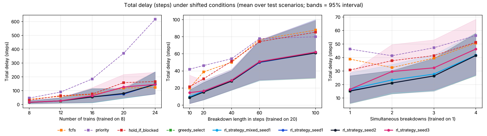
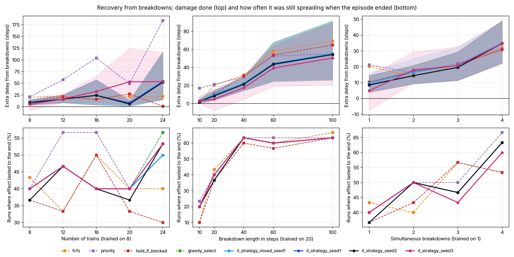

# Flatland Railways

**Simulation Based Evaluation of Reinforcement Learning for Robust Railway Traffic Rescheduling Under Dynamic Disruptions**

Final-year project, B.Tech CSE, Maharaja Surajmal Institute of Technology.
Anamika Aggarwal, Drishya Garg, Prachi Kumari. Supervised by Ms. Amita Yadav.

We use the [Flatland-RL](https://github.com/flatland-association/flatland-rl) railway simulator to compare a reinforcement-learning dispatcher with simple rule-based dispatchers (First-Come-First-Served, Priority), and to measure how a trained policy holds up when traffic and disruptions differ from what it was trained on.

## Setup

```bash
python -m venv venv
source venv/bin/activate        # Windows: venv\Scripts\activate
pip install -r requirements.txt
```

The code is written for **flatland-rl 4.3.0**. Older versions (3.x) use a different agent API and the scripts will not work with them.

## Scripts

| Script | What it does |
|---|---|
| `python initial-rail.py` | Builds the base 30x30 scenario and prints each train's start, target and timetable. |
| `python railway.py` | Draws the railway network in a window. Use `--save outputs/network.png` to save an image instead (works without a screen). |
| `python train-movement.py` | Runs 5 trains with no dispatcher (always move forward) and reports departures, arrivals, blocking and deadlocks step by step. |
| `python run_experiment.py` | Runs every policy on the same batch of disrupted scenarios, prints averages and writes one CSV row per run to `outputs/results.csv`. See `--help` for options (trains, number of scenarios, breakdown count/duration, simultaneous, `--model` for RL). |
| `python train_rl.py` | Trains an RL policy with PPO (see "Reinforcement learning"). |
| `python run_robustness.py` | Runs all policies, frozen, under shifted conditions (see "Robustness study"). |
| `python analyse_robustness.py` | Summaries, paired significance tests and degradation-curve plots for the robustness study. |

## Code layout

```
railsim/
  env_factory.py   EnvConfig + make_env(): the one place the environment is built;
                   usable_seeds() skips seeds where Flatland changes the city layout
  train_status.py  train position/direction/target helpers, deadlock detection
  disruptions.py   DisruptionSpec, planned breakdowns, Flatland hook that applies them
  policies.py      dispatching policies: always_forward, shortest_path (no dispatcher),
                   fcfs, priority (rule-based, conflict-free)
  planner.py       conflict-free route booking in space and time, used by fcfs/priority
  strategy.py      ordering rules (fcfs, priority, edf, spf), greedy_select, RL strategy
                   selection (StrategyEnv, RLStrategy)
  rl_dispatch.py   departure control: release_all, hold_if_blocked, RL Dispatch/Wait
  metrics.py       delay, recovery time, EpisodeResult
  runner.py        run_episode(): play one policy on one scenario and measure it
docs/
  literature_review.md          sources and how each one shaped the design
tests/
  test_railsim.py               reproducibility and deadlock-detector checks
  test_disruptions_metrics.py   disruption, metric and runner checks
  test_dispatchers.py           planner and FCFS/Priority checks
  test_strategy.py              strategy selection and its training environment
  test_rl_dispatch.py           departure control and its training environment
```

All scripts build their environment through `make_env(EnvConfig(...))`, so the same config and seed always give the same network, trains and timetable.

### How deadlocks are detected

`find_deadlocked_trains(env)` returns trains that can never move again, whatever actions they are given: every cell a train could enter is held by another deadlocked train. This covers head-on deadlocks, trains stuck behind them, and circular waits.

Flatland also has `env.motion_check.deadlocked`, but that is a per-step flag meaning "these trains tried to swap cells this step". It fires even when one of the trains could still turn away at a switch, so it is not used as the deadlock measure here.

### Disruptions

A disruption is a train breakdown: the train stops where it is for a fixed number of steps and blocks the track behind it. If it has not departed yet, its departure is delayed instead.

```python
from railsim.disruptions import DisruptionSpec
from railsim.env_factory import EnvConfig, make_env

env, obs, info = make_env(EnvConfig(num_trains=8, seed=3),
                          DisruptionSpec(count=2, duration=20, simultaneous=False))
env.disruption_plan   # [Disruption(train=..., start_step=..., duration=20), ...]
```

The plan is drawn from the timetable only (each breakdown starts while that train is scheduled to be running), never from what happens during the run. So every policy faces exactly the same disruptions for a given seed. Adding disruptions does not change the network or timetable.

Not implemented yet: speed restrictions and track closures without a train on them.

### Policies

| Policy | What it does |
|---|---|
| `always_forward` | Every train always moves forward. Ignores routes and other trains. |
| `shortest_path` | Every train follows its shortest route and departs as soon as allowed; nobody ever waits for anyone (Flatland's `ShortestPathPolicy`). This is "no dispatcher". |
| `fcfs` | Rule-based dispatcher. Trains book conflict-free routes in order of scheduled departure (first come, first served). |
| `priority` | Rule-based dispatcher. Trains book routes in order of least slack: the train closest to missing its latest arrival goes first. Recomputed at every re-plan (Chen et al. 2023). |
| `edf` | Rule-based. Earliest deadline (latest arrival) first. |
| `spf` | Rule-based. Shortest remaining trip first. |
| `greedy_select` | Rule selection, no learning. At every re-plan it plans with all four orderings above and keeps the plan with the least lateness. |
| `release_all` | Departure control, no learning: every train is released as soon as it is ready; released trains book in release order. |
| `hold_if_blocked` | Departure control, no learning: a ready train is released only if its route is free right now. |
| `rl_strategy_*` | **RL**: a trained model chooses the ordering rule at every re-plan. |
| `rl` | RL departure control (Dispatch/Wait per ready train). Kept for the record; see below. |

**How `fcfs` and `priority` work** (`railsim/planner.py`): trains are planned one at a time in priority order. Each one searches for its earliest possible arrival, moving one cell per step or waiting (holding at its station or on the track), while avoiding every cell already booked by the trains before it. Its route is then booked. Booked routes never share a cell at the same time and never swap cells head-on, so these dispatchers cannot deadlock (checked in the tests). The two rules differ only in the order trains get to book.

They re-plan from the current state whenever a train is not where its plan says (for example, a breakdown has just stopped it), and every 5 steps while some train has no route. They learn about a breakdown only when it happens, and are then told how long it will last.

A train that has not departed and cannot reach its target before the episode ends is held at its station (it counts as not arrived).

### Metrics

| Metric | Definition |
|---|---|
| Arrived % (throughput) | Trains that reached their target / all trains |
| Arrived on time | Arrived no later than `latest_arrival` |
| Total delay | Sum over trains. Arrived: `max(0, arrival - latest_arrival)`. Not arrived: how late it would be if it ran its shortest path from where it is now, `max(0, now + remaining travel time - latest_arrival)`. Same convention as Flatland's reward; equals minus Flatland's episode reward when every train departs (checked in the tests). |
| Deadlocked | Trains that can never move again at the end of the episode |
| Recovery time | Steps from the first breakdown until the breakdowns stop adding delay. The same policy is also run on the same scenario without breakdowns; the extra delay is the difference between the two runs. Recovered = the first step (no earlier than the step after the last breakdown ends) from which the extra delay never changes again. Delay already caused stays; recovery means it stops growing. `None` = still changing when the episode ended. **Only meaningful for policies that do not deadlock**: a deadlocked network freezes, so its extra delay also stops changing. In practice it is mostly yes/no: in most runs the breakdowns either caused no extra delay at all, or their effect lasted until the last trains arrived; on average only 15% of runs recovered part-way (0-45% depending on the condition; see "Recovery from breakdowns"). |
| Extra delay | Total delay with breakdowns minus total delay of the same policy on the same scenario without breakdowns: how much damage the breakdowns did. Always defined, so it can be compared scenario by scenario. Can be slightly negative (2% of runs): stopping a train occasionally avoids a conflict by chance. |
| Replans | How many times a rule-based dispatcher re-planned |
| Decision time | Wall-clock time the policy takes to choose actions per step |

The delay of a train that is not arrived is optimistic for deadlocked trains (they will never arrive), so always read delay together with arrived % and deadlocked.

### Reinforcement learning

All RL policies sit on top of the same conflict-free planner, so they **cannot cause deadlocks**; they only make the decisions the rule-based dispatchers make by fixed rules.

**What we tried first: RL departure control** (`railsim/rl_dispatch.py`, `--task departure`). The agent decides, for each train ready to leave, Dispatch or Wait (the split used by Castagna et al. 2026). What happened:
1. From scratch, PPO collapsed to "always Wait" (0% arrived). A single Wait only delays a train one step, so the benefit of waiting is rarely found by chance.
2. After fixing the discounting and starting from imitation of `hold_if_blocked` (as Castagna et al. start from a heuristic), PPO could not improve on the rule; validation only flipped between the rule (17.1) and `release_all` (22.6).
3. Hand-written variants of the rule were all worse, and giving released trains the Priority order made things much worse (47). The reason: FCFS/Priority plan **every** train in the timetable in advance, while a departure-control dispatcher only plans trains already released, so it lacks that foresight.

Conclusion: in this setup, when to release a train is close to optimal with a simple rule; the room for improvement is in the **booking order**.

**Final design: RL strategy selection** (`railsim/strategy.py`, `--task strategy`, default). On validation scenarios no single ordering rule was best: picking the better of FCFS/Priority per scenario cut delay by a third. Li et al. (2021) likewise ran several orderings and kept the best. So at every re-plan (the start, and whenever a breakdown knocks a train off its plan) the agent chooses which ordering rule (`fcfs`, `priority`, `edf`, `spf`) re-plans the network.

| Piece | What it is |
|---|---|
| `StrategyEnv` | Gymnasium env: one step = one re-plan decision (about 4-5 per episode). Reward = minus the increase in network delay / N; with no discounting the episode return is exactly -(total delay)/N. |
| `strategy_observation()` | 22 numbers: time, trains on track/arrived/waiting/broken, slack statistics, and for each rule how late its plan would make the trains, which rule's plan is best, and which rule is in use. |
| `greedy_select` | Strongest non-learning baseline: always the rule whose plan is least late. RL must beat this to show that learning adds something. |
| Warm start | Before PPO, the policy imitates `greedy_select` (99% matching choices) and the value function is fitted to its returns. Then PPO fine-tunes. |
| Training | 8 trains, 1 breakdown of 20 steps. Seeds: training from 1000, validation from 5000, test from 0. 3 PPO seeds (60,000 decisions each, about 40 to 47 minutes on 4 CPU cores). The best checkpoint on validation is kept. |
| Mixed control | `--task strategy_mixed` trains on varied conditions (6 to 12 trains, 10 to 40 step breakdowns, 1 or 2 breakdowns) to test whether broader training reduces degradation, as Yue et al. (2024) found. Validation stays on the standard conditions. |

Checks (in `tests/`): the training environments pass Stable-Baselines3's checker; rewards add up exactly to the delay metric; and choosing a fixed rule, or the greedy choice, inside the training environment gives exactly the same result as running that dispatcher normally.

```bash
python train_rl.py --task strategy --seed 1
python run_experiment.py --policies priority greedy_select rl_strategy --model results/models/rl_strategy_seed1.zip
```

### Robustness study

`run_robustness.py` freezes the trained policies and changes one condition at a time away from training (8 trains, 1 breakdown of 20 steps):

| Shift | Levels |
|---|---|
| Traffic density | 8, 12, 16, 20, 24 trains (+0% to +200%) |
| Breakdown length | 10, 20, 40, 60, 100 steps |
| Simultaneous breakdowns | 1, 2, 3, 4 |

Every policy runs the same test scenarios at every level, so results are paired. `analyse_robustness.py` gives means with 95% bootstrap intervals, paired Wilcoxon signed-rank tests (RL vs each baseline, per scenario) and degradation-curve plots.

```bash
python run_robustness.py --seeds 30 --models results/models/rl_strategy_seed1.zip results/models/rl_strategy_seed2.zip results/models/rl_strategy_seed3.zip results/models/rl_strategy_mixed_seed1.zip
python analyse_robustness.py
```

## Results

All numbers are on **test scenarios** (seeds 0 to 31, never used in training or validation), **30 scenarios per condition**, for 7 rule-based policies and 4 RL models (PPO seeds 1 to 3 trained on fixed conditions, plus one trained on mixed conditions): 4,620 runs in all. Full data: `results/robustness/` (per-run CSV, summaries with 95% intervals, paired tests, plots). Trained models: `results/models/`. Training logs: `results/training/`.

An earlier version of this study used 20 scenarios and 2 RL seeds (`results/robustness/robustness_20scenarios.csv`). On those 20 scenarios the final study gives exactly the same results (all 2,520 shared runs, 22 result columns).

### Training conditions (8 trains, 1 breakdown of 20 steps)

| Policy | Total delay | Arrived | Cancelled trains |
|---|---|---|---|
| fcfs | 38.9 | 92.5% | 0.27 |
| priority | 46.3 | 88.8% | 0.20 |
| edf | 28.0 | 93.3% | 0.27 |
| spf | 32.3 | 92.1% | 0.37 |
| release_all | 31.1 | 93.8% | 0.27 |
| hold_if_blocked | 30.8 | 93.8% | 0.27 |
| greedy_select | 15.2 | 96.7% | 0.10 |
| rl_strategy_seed1 | 15.5 | 96.2% | 0.10 |
| rl_strategy_seed2 | 15.2 | 96.7% | 0.10 |
| rl_strategy_seed3 | 16.5 | 95.8% | 0.10 |
| rl_strategy_mixed_seed1 | 16.5 | 95.8% | 0.10 |

No policy had a single deadlock in any of the 4,620 test runs (all use the conflict-free planner).

### Degradation under shifted conditions



Mean total delay over 30 test scenarios (lower is better):

| Shift | Level | fcfs | priority | hold_if_blocked | greedy_select | rl seed 1 | rl seed 2 | rl seed 3 | rl mixed |
|---|---|---|---|---|---|---|---|---|---|
| Trains | 8 (training) | 38.9 | 46.3 | 30.8 | 15.2 | 15.5 | 15.2 | 16.5 | 16.5 |
|  | 12 | 58.8 | 90.2 | 64.1 | 24.2 | 26.0 | 26.0 | 26.2 | 26.0 |
|  | 16 | 72.8 | 184.8 | 76.0 | 54.7 | 54.7 | 54.7 | 63.0 | 54.7 |
|  | 20 | 119.5 | 371.1 | 158.3 | 75.9 | 75.0 | 79.9 | 126.6 | 75.1 |
|  | 24 | 123.0 | 617.2 | 166.2 | 146.2 | 146.7 | 145.4 | 144.9 | 147.7 |
| Breakdown length | 10 | 19.9 | 42.0 | 21.5 | 8.7 | 8.7 | 8.7 | 14.6 | 9.7 |
|  | 20 (training) | 38.9 | 46.3 | 30.8 | 15.2 | 15.5 | 15.2 | 16.5 | 16.5 |
|  | 40 | 50.1 | 54.3 | 51.3 | 28.0 | 28.1 | 28.1 | 29.1 | 29.1 |
|  | 60 | 76.7 | 77.8 | 74.2 | 50.4 | 49.9 | 50.5 | 50.9 | 50.9 |
|  | 100 | 87.8 | 80.0 | 85.3 | 61.0 | 61.0 | 61.0 | 62.1 | 62.1 |
| Simultaneous breakdowns | 1 (training) | 38.9 | 46.3 | 30.8 | 15.2 | 15.5 | 15.2 | 16.5 | 16.5 |
|  | 2 | 32.6 | 41.3 | 37.7 | 21.2 | 21.2 | 21.2 | 29.7 | 23.4 |
|  | 3 | 39.6 | 47.3 | 41.5 | 26.4 | 26.4 | 26.4 | 32.4 | 27.8 |
|  | 4 | 50.7 | 56.3 | 51.3 | 41.5 | 41.5 | 41.5 | 46.3 | 41.8 |

### What the results show

1. **Choosing the ordering rule at every re-plan is the main gain.** greedy_select and the RL models have the lowest delay in 13 of 14 conditions. The gap is largest at moderate density: at 16 trains, 54.7 against 72.8 to 184.8 for the fixed ordering rules, significant against every one of them for RL seeds 1, 2 and the mixed model (paired Wilcoxon, p ≤ 0.011).
2. **The RL models learned to copy greedy_select, not to beat it.**
   - They choose the same rule as greedy on 93% to 98% of decisions under training conditions, and on 92% to 98% with 20 to 24 trains (30 test scenarios). Seed 3 deviates most (92% to 95%), seed 2 least (98%).
   - Their delay never differs significantly from greedy at any level (smallest p = 0.16, for seed 3).
   - On validation, the best scores were 7.17 (seeds 1 and 3, mixed) and 7.10 (seed 2), against 7.10 for greedy.
3. **When PPO did not copy greedy, it was usually worse.** Seed 3 ties greedy in 24 to 28 of 30 scenarios at every level, but where it differs it mostly loses: at 20 trains, 5 worse scenarios lift its mean to 126.6 against 75.9 for greedy. None of its differences is significant (p ≥ 0.16).
4. **Mixed-condition training did not make the policy more robust.** The model trained on 6 to 12 trains, 10 to 40 step breakdowns and 1 or 2 breakdowns behaves like the fixed-condition models: it ties greedy and seed 1 in 25 to 30 of 30 scenarios at every level, and no difference is significant (all p ≥ 0.125). This holds both inside its training range and outside it (16 to 24 trains, 60 to 100 steps, 3 or 4 breakdowns). Unlike Yue et al. (2024), broader training changed nothing here, most likely because both policies converge to the same greedy behaviour.
5. **Robustness boundary: heavy traffic.** At 24 trains (+200%), plain FCFS has the lowest mean delay: 123.0 against 144.9 to 147.7 for greedy and RL. The difference is **not significant** (p = 0.13 to 0.18), and per scenario RL is better than FCFS in 13 to 14 scenarios and worse in 6 to 7, losing a few by large margins. So the honest reading is that the advantage **disappears** at this density, not that it reverses.
6. **Longer and simultaneous breakdowns:** every policy gets worse, but the ranking stays the same and greedy/RL stay best at every level. At 100-step breakdowns: 61.0 to 62.1 against 80.0 (priority), 85.3 (hold_if_blocked) and 87.8 (fcfs). At 4 simultaneous breakdowns: 41.5 to 46.3 against 50.7 to 56.3.
7. **RL departure control could not beat a simple rule** (see "Reinforcement learning" above). In this setup, when to release a train matters less than the booking order.

### Recovery from breakdowns

How much damage the breakdowns did (extra delay, see Metrics) and, in brackets, the share of runs where that damage was still growing when the episode ended. Mean over 30 test scenarios; lower is better. Data: `results/robustness/recovery_summary.csv`, paired tests in `results/robustness/recovery_paired.csv`.

| Shift | Level | fcfs | priority | hold_if_blocked | greedy_select | rl seed 1 | rl seed 2 | rl seed 3 | rl mixed |
|---|---|---|---|---|---|---|---|---|---|
| Trains | 8 (training) | 20.2 (43%) | 21.2 (40%) | 10.3 (37%) | 8.4 (37%) | 8.7 (40%) | 8.4 (37%) | 4.8 (40%) | 9.7 (40%) |
|  | 12 | 22.7 (33%) | 57.5 (57%) | 20.8 (33%) | 15.6 (47%) | 16.2 (47%) | 16.2 (47%) | 16.4 (47%) | 16.2 (47%) |
|  | 16 | 16.0 (50%) | 103.8 (57%) | 15.7 (50%) | 24.2 (40%) | 24.2 (40%) | 24.2 (40%) | 32.5 (40%) | 24.2 (40%) |
|  | 20 | 21.6 (40%) | 49.3 (40%) | 27.2 (33%) | 8.0 (40%) | 8.1 (40%) | 5.6 (37%) | 53.2 (40%) | 8.0 (40%) |
|  | 24 | 21.9 (40%) | 183.9 (53%) | 0.9 (30%) | 53.6 (57%) | 53.4 (53%) | 52.2 (53%) | 53.6 (53%) | 54.5 (50%) |
| Breakdown length | 10 | 1.2 (10%) | 16.9 (23%) | 1.1 (10%) | 1.9 (20%) | 1.9 (20%) | 1.9 (20%) | 2.9 (20%) | 2.9 (20%) |
|  | 20 (training) | 20.2 (43%) | 21.2 (40%) | 10.3 (37%) | 8.4 (37%) | 8.7 (40%) | 8.4 (37%) | 4.8 (40%) | 9.7 (40%) |
|  | 40 | 31.4 (63%) | 29.2 (63%) | 30.9 (60%) | 21.2 (63%) | 21.3 (63%) | 21.3 (63%) | 17.4 (63%) | 22.3 (63%) |
|  | 60 | 58.0 (60%) | 52.7 (63%) | 53.8 (57%) | 43.6 (60%) | 43.1 (60%) | 43.7 (60%) | 39.2 (60%) | 44.1 (60%) |
|  | 100 | 69.1 (67%) | 54.8 (63%) | 64.9 (63%) | 54.2 (63%) | 54.2 (63%) | 54.2 (63%) | 50.4 (63%) | 55.3 (63%) |
| Simultaneous breakdowns | 1 (training) | 20.2 (43%) | 21.2 (40%) | 10.3 (37%) | 8.4 (37%) | 8.7 (40%) | 8.4 (37%) | 4.8 (40%) | 9.7 (40%) |
|  | 2 | 14.0 (40%) | 16.2 (50%) | 17.2 (43%) | 14.4 (50%) | 14.4 (50%) | 14.4 (50%) | 18.0 (50%) | 16.6 (50%) |
|  | 3 | 21.0 (57%) | 22.2 (50%) | 21.0 (57%) | 19.6 (47%) | 19.6 (47%) | 19.6 (47%) | 20.7 (43%) | 21.0 (47%) |
|  | 4 | 32.1 (53%) | 31.1 (67%) | 30.8 (53%) | 34.7 (63%) | 34.7 (63%) | 34.7 (63%) | 34.6 (60%) | 35.0 (63%) |



What this shows:
- **Under training conditions the breakdown damage is not significantly different between policies.** greedy/RL had 4.8 to 9.7 extra delay against 20.2 (fcfs) and 21.2 (priority), but the damage was the same in 20 to 22 of 30 scenarios and the differences are not significant (p = 0.31 and 0.49). The lower total delay of greedy/RL comes mainly from better plans, not from absorbing breakdowns better.
- **Long breakdowns hurt every policy about equally.** From 40 steps on, all policies lose 17 to 69 steps, the effect lasts to the end in 57% to 67% of runs, and no difference against RL is significant (all p ≥ 0.10). Re-planning cannot win back a long blockage.
- **At 20 trains, RL seeds 1, 2 and the mixed model contain breakdowns better than several rules:** 5.6 to 8.1 extra delay against 21.6 (fcfs), 35.6 (release_all) and 50.5 (edf), p = 0.002 to 0.016. Seed 3 does not (53.2). These are a few significant results among many comparisons, so treat them as indications.
- **At 24 trains the picture is mixed.** Without breakdowns greedy/RL are only slightly better than FCFS (92.7 against 101.1), and breakdowns add more to their plans (52 to 55 against 21.9), but that difference is not significant (p = 0.32 to 0.50). With 20 scenarios we read this as "tightly packed plans are fragile"; with 30 scenarios it is a possible explanation, not an established one. hold_if_blocked shows only 0.9 extra delay because its network is already congested without breakdowns (165.3), so the breakdowns add little (RL has more extra delay than it, p ≤ 0.007).
- **Recovery time is mostly a yes or no measure.** Only 17% of runs recovered part-way (10% to 23% under training conditions). When they did, the median was 31 to 33 steps after a 20-step breakdown.

**Confound: not every planned breakdown happens.** Breakdowns are planned from the timetable (so every policy gets the same plan), but if the chosen train has already arrived when its breakdown is due, nothing happens. Overall 32% of planned breakdowns never happened; by policy, 28% (priority) to 33% (hold_if_blocked). A policy that gets trains in sooner can therefore dodge some breakdowns. The difference between policies is small, but it should be kept in mind when comparing breakdown damage.

### Limitations

- **Sample size:** 30 test scenarios per condition, 3 fixed-condition PPO seeds and 1 mixed-condition model. Differences of a few steps are within noise; see the p-values in `results/robustness/robustness_paired.csv` and `robustness_rl_vs_rl.csv`.
- **The agent can't do better than the options it is given.** RL chooses among four ordering rules re-planned by the same planner; what it can achieve is bounded by those rules.
- **What RL learned was mostly imitation.** It was warm-started by imitating greedy_select, and PPO fine-tuning did not move it far; where it did move (seed 3), it got worse. Training from scratch failed in the departure-control experiment.
- **The dispatchers know each breakdown's length** once it happens; a real dispatcher would only have an estimate.
- **Disruptions are train breakdowns only.** Speed restrictions and track closures without a train on them are not modelled.

## Tests

```bash
python -m pytest tests/
```

## Notes

- Flatland sets the episode length itself from the timetable (for example 98 steps for 5 trains, seed 42).
- For some seeds Flatland cannot fit 3 cities on a 30x30 grid and warns that it is switching to grid mode or placing fewer cities. The scenario still runs, but its layout differs from the others.
